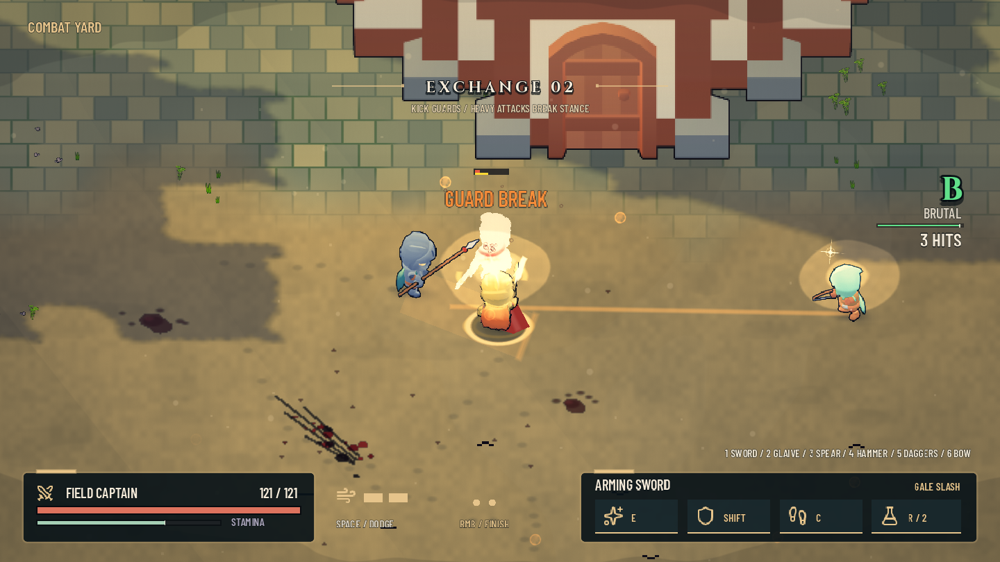
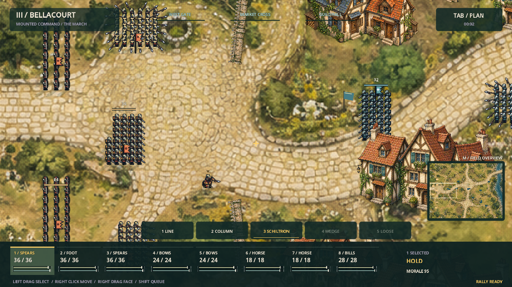
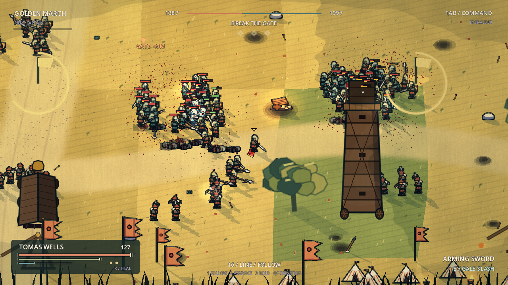
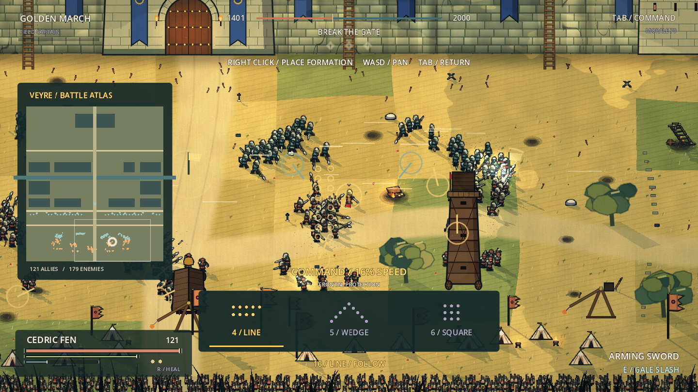
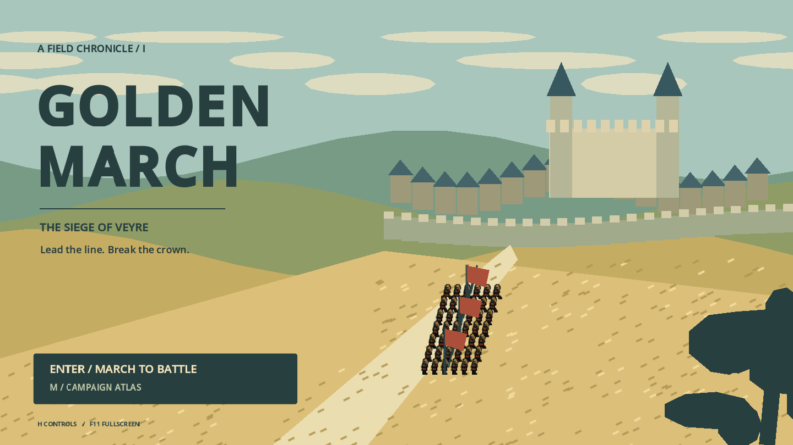
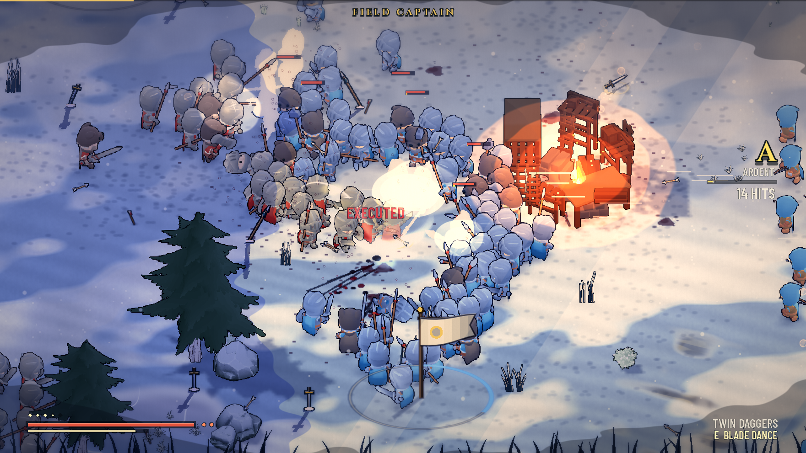

# GOLDEN MARCH — Iron & Ember combat polish

**Start here:** import the root `project.godot`, press F5, then **T** on the title screen for the new **Combat Yard**. Keys **1–6** switch between sword, glaive, spear, hammer, daggers and bow. Enter still starts the siege; 3 starts Bellacourt.

This pass improves the live combat loop as well as presentation: two recharging dodge charges, instant parry timing, a stronger counter after a parry or close dodge, faster linked attacks, movement during attacks, narrower aim assist, and melee occlusion against solid scenery. Holding left mouse chains attacks; two lights into right mouse triggers the existing weapon finisher.

The controlled soldier now has live cloth, warm rim lighting and a foot marker. Ground attack cues distinguish sweeps, thrusts and unblockables. New supply caches restore stamina/spirit and marked oil barrels knock enemies down. Terrain is quieter, Bellacourt has more street props, and command routes follow the actual navigation path. The HUD shows health, stamina, dodge charges and ability readiness; **F7** reduces camera motion.

[Design references, exact changes and validation](docs/POLISH_NOTES.md). The existing chapters and documentation below remain available.

**New: Chapter III, Bellacourt.** On the title screen, press **3** or click **COMMAND BELLACOURT**. You can also launch it from the third campaign-atlas entry. Chapters I and II remain available.

You are a mounted marshal commanding eight independent companies, with 469 soldiers across the two armies. Select, queue routes, set facing, form columns for streets, brace spear schiltrons and coordinate cavalry / bows. The new city is assembled from eight original generated paintings, with low town walls and separate building footprints. [Chapter III field book](docs/CHAPTER_III.md).

A playable Godot action / formation strategy game. This update rebuilds the supplied Kingdom Rise project around dense companies, a warm illustrated European siege, and deliberate battlefield command. The original melee combat, possession, siege machinery, multi-level navigation and officer duels remain playable.

## Play

1. Extract the complete folder.
2. In **Godot 4.5.1 or newer** (this update was built and tested with 4.7.2), choose **Import** and select `project.godot`.
3. Press **F5**. Enter or click on the title to start the siege. **M** opens the campaign atlas instead.

This is the complete editable **Godot project**, not an Unreal project or a compiled Windows executable. Use the standard Godot build; .NET is not required. Soldiers, horses, buildings, trees and siege engines are pre-rendered sprite sheets (`assets/units`, `assets/props`) baked from free CC0 3D models; effects, music and sound effects are free CC0 assets; fonts are OFL. Everything ships in the folder, so nothing is downloaded at runtime. See [CREDITS.md](CREDITS.md).

## What changed

- **300 active soldiers at the opening**: 121 allied soldiers including the player, and 179 enemies. Five allied companies meet four enemy sortie companies, backed by wall archers and garrisons. This is approximately three times the original siege deployment. Reinforcements sustain the battle.
- **Army density presets**: Standard caps 90 allies / 130 enemies; War caps 150 / 230; Epic caps 220 / 340. War is the default. F6 cycles presets. Reducing density returns distant non-command troops to reserves, preserving army strength.
- **Command immediately**: you begin as a Field Captain with up to 16 followers. Promotions increase your command to 20, 24, 32, 40 and eventually 48 soldiers.
- **Line, wedge and square**: actual slots, reforming, cohesion and combat effects. Rank-and-file companies retain ranks outside combat and use shorter pursuit leashes.
- **Tactical time**: Tab pulls the camera back and slows time to 16%. WASD pans. Right-click places the selected formation. Formation cards can be clicked or selected with 4/5/6. The command atlas shows city blocks, canal, walls, units and camera position.
- **Three contested approaches**: West Orchard, Ram Road and East Fields. Nearby numerical advantage captures a point over time. Captured ground boosts morale, then gradually drains the opposing side's morale and reserves. The three diamonds above the battlefield show ownership.
- **A new visual direction**: harvest fields, wheel-rutted roads, wheat, poppies, dry-stone boundaries, orchard trees, limestone walls, slate / terracotta roofs, a chapel and a castle keep. Rust cloth and cool teal identify the armies.
- **Character and weapon polish**: eight-frame infantry walks, smoother acceleration, stronger silhouettes, nasal helms / bascinets, heater shields with heraldry, arming swords, straight greatswords, leaf-headed pikes and halberds. Fast dashes, parries, weapon skills and finishers remain.
- **Minimal combat HUD**: compact vitals, a narrow army balance, one objective, a quiet command status and a weapon label. Detailed controls and the atlas appear only when requested. The title, pause menu, manual and promotion presentation are restyled.

## Visual and combat overhaul

- **Real art instead of vector placeholders.** Soldiers are rendered from the KayKit 3D characters in five directions (west-facing ones mirrored) with walk, run, attack, block, dodge, hit, death and other animations. A separate weapon layer is drawn per loadout, and team cloth is recoloured per army by a shader. Cavalry come from a Quaternius horse with a rider pose. Buildings, trees, rocks and props are baked from the KayKit medieval and Quaternius nature packs, each with its own cast shadow.
- **Dense, layered scenes.** Forest edges, lone oaks, rocks, camps and thousands of clutter tufts are drawn in batched chunks. All prop shadows merge into one ground shadow map. Trees and grass sway in the wind. The snow plains are re-dressed with snow-laden pines, dead trees, frosted brush and snow-capped boulders over new wind-sculpted snow. The siege wall, gatehouse and towers share one weathered-stone shader.
- **Combat redesign.** Sizes and hitboxes match the new sprites, and HP is rebalanced per troop type. Attacks have readable wind-up, active and recovery frames, with swing trails that follow the weapon tip. There are hit flashes, impact stars, blood arcs and hit-stop. Deaths fall back, play out and leave corpses that are later stamped into the ground. Heavy hits trigger a radial zoom-blur impact frame.
- **Dynamic camera.** A critically damped follow with look-ahead and aim pull. The camera frames the centre of the nearby fight and zooms with context: tighter in a duel, wider in a melee or a charge. Shake uses trauma with noise, plus spring kicks, zoom punches and roll.
- **Minimal HUD.** Vitals bottom left fade when calm. Weapon and skill sit bottom right. Objective and army balance show only briefly after they change. Banners and alerts are understated.
- **Sound.** Recorded sample banks with random variants and layered heavy hits replace the synthesised effects. Music crossfades between title, battle and boss tracks.
- **Title screen.** A live diorama built from the same baked art: the March's columns wind up the road to Veyre in the golden hour under a slow camera push, with an editorial title and a minimal menu.

## Formation choices

| Formation | Shape and combat effect | Use |
| --- | --- | --- |
| Line | Two or more ranks; up to 25% frontal damage reduction at full squad cohesion | Hold a broad approach and cover the ram |
| Wedge | Staggered V; up to 22% attack bonus on an advance order at full cohesion | Concentrate an assault on a weak point |
| Square | Perimeter slots; soldiers face outward, with up to 35% directional protection at full cohesion | Resist attacks from several directions |

Bonuses depend on soldiers actually reaching their positions. Breaking cohesion weakens them. Flanking the unprotected side of an organised soldier increases clean melee damage by 20%. Formations are deliberately imperfect around narrow ladders, gates and solid buildings; navigation resolves the obstruction and troops reform in open ground.

## Controls

| Key | Action |
| --- | --- |
| WASD / arrows | Move; pan in command view |
| Mouse | Aim |
| Left mouse | Light attack / hold to chain |
| Right mouse | Heavy attack; hold to charge |
| Light, light, heavy | Weapon finisher |
| Space | Two-charge dodge; perfect dodge primes a counter |
| Shift | Guard; time the press for a parry |
| E / R | Weapon skill / healing flask |
| F | Interact, pick up weapon, mount, challenge an officer |
| C / T or middle mouse | Kick / throw weapon |
| Tab | Toggle command view |
| Right mouse in command view | Place formation and advance |
| 1 / 2 / 3 | Follow / advance to cursor / hold |
| Q / 4 / 5 / 6 | Cycle formation / line / wedge / square |
| Mouse wheel | Adjust combat zoom |
| X | Release a full General's Aura |
| G / V | War cry / arrow volley at the original rank unlock |
| Backspace during possession | Cycle surviving allies; Enter chooses one |
| H / Esc | Field manual / pause |
| F2 / F6 / F7 / F11 | Low graphics / army density / reduced camera motion / fullscreen |

Keyboard and mouse are recommended for formation command. The original gamepad combat bindings remain; the new command view and formation selectors use keyboard / mouse.

## The siege

Capture the approaches and protect the covered ram, use the six scaling ladders, or escort the two rolling siege towers. Wall defenders reinforce and pour burning oil. Watch the landing warnings from the trebuchets. Breach the gate or take the wall, fight through the town and across the canal, defeat the two ward commanders, and reach Lord Aldric in the keep courtyard. Soldiers fight on their own elevation; archers can fire across levels. When the controlled soldier falls, choose another allied body and retain your rank and legacy.

The snow-plains field battle is Chapter II. Chapter III is now the playable commander battle at Bellacourt, replacing the earlier unplayable river placeholder. The sealed historical scenarios remain planned entries.

## Performance and validation

F2 reduces lighting, bloom and shadow work. F6 reduces active simulation density independently. Epic is optional and has not been benchmarked on desktop gaming hardware. Start with War and adjust for your machine.

Tested with the actual Godot 4.5.1 runtime, including rendered title, battle, command view, campaign atlas, city and keep. Integration checks exercise formations, orders, density conservation, death / possession and six navigation routes. See `docs/PLAYTEST.md` for exact scope and limitations.

## Code map

- `scripts/strategy/formation_director.gd`: regiment membership, formation geometry, command input, cohesion, capture points, density presets and integration checks.
- `scripts/world/battle.gd`: battle loop, recruitment, reserve waves and combat camera.
- `scripts/ai/ai_brain.gd`: formation-aware marching and pursuit limits.
- `scripts/combat/unit.gd`: directional protection, flank damage, advance attack bonus, movement and animation.
- `scripts/world/siege.gd`: siege collision, route logic, machines and phases.
- `scripts/core/unit_art.gd`, `prop_art.gd`: load the baked soldier / prop sheets and their metadata.
- `scripts/world/scenery.gd`: places baked props, clutter chunks and the merged ground shadow map.
- `tools/bake_units.gd`, `bake_cavalry.gd`, `bake_props.gd`, `bake_siege.gd`: re-render the sprite sheets from `art_src/` (run with `godot --path . --script res://tools/bake_units.gd`).
- `scripts/world/golden_landscape.gd`, `medieval_props.gd`, `city_art.gd`, `shaders/harvest_ground.gdshader`: vector environment pieces still used by the city and Chapter III, and the siege terrain.
- `scripts/core/art.gd`, `art_props.gd`: generated soldier and weapon atlases.
- `scripts/ui/title.gd`, `hud.gd`: title, manual, compact HUD and tactical atlas.
