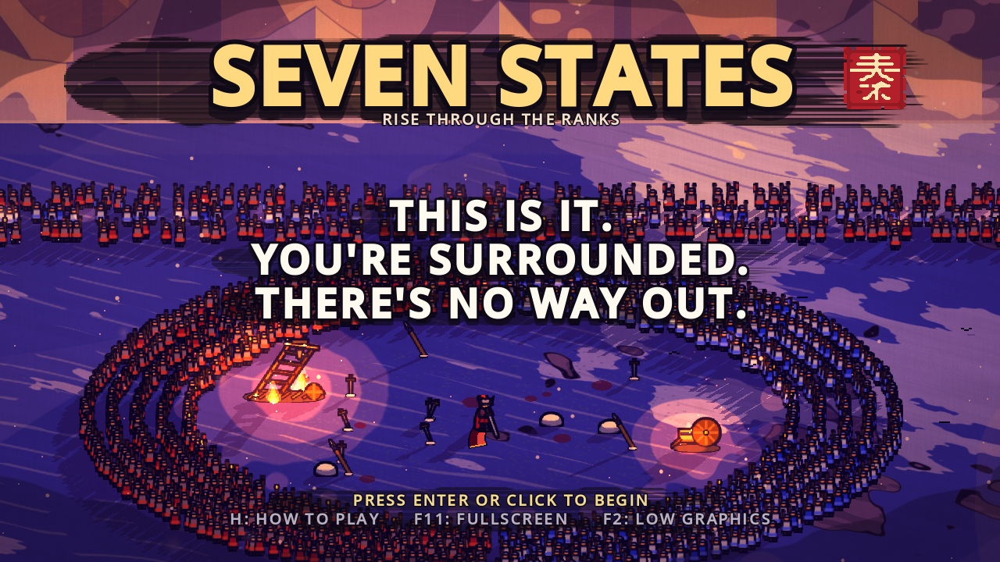
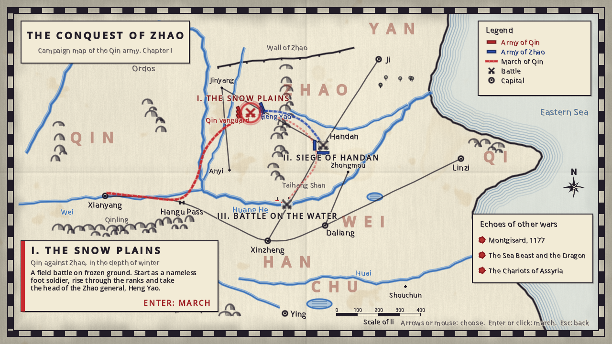
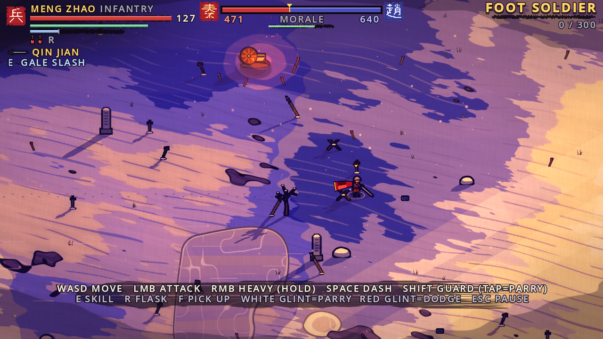
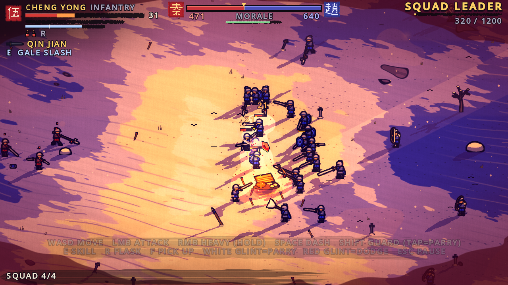
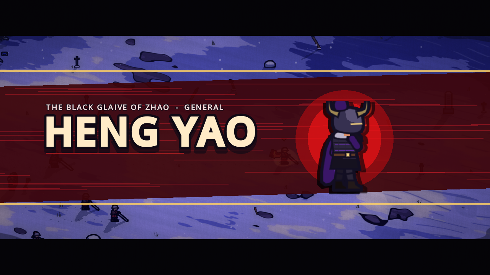
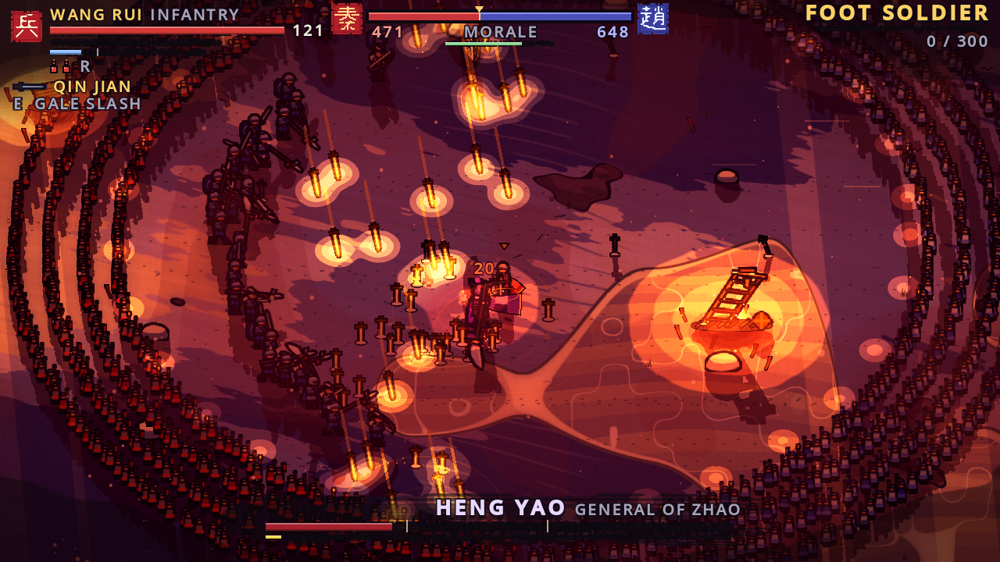

# Seven States: Rise Through the Ranks

A fast war game in a painted-poster style, inspired by *Kingdom* (the manga), with combat depth
borrowed from *Elden Ring* and pace borrowed from *ULTRAKILL*.

You start as a nameless foot soldier of Qin in a huge battle on the snow plains against Zhao.
You fight, get promoted (Squad Leader, 100-Man, 1000-Man and 5000-Man Commander, then General), and
finally duel the enemy general inside a ring formed by both armies.
**When you die, you take over another soldier on the battlefield.** Your rank and perks carry over;
the body, its stats and its weapon change.








## Campaign map
After the title and briefing you arrive at the **campaign war map**, drawn like an old printed
staff map (after the 1757 Weser campaign map). It has cream paper with fold creases, blue
meandering rivers, hachured hills, a water-lined coast, red (Qin) and blue (Zhao) army bars,
dashed march routes, a legend and a scale of li. The geography is stylised Warring States China, not an accurate map.

| Battle | Status |
|---|---|
| I. The Snow Plains | **Playable** |
| II. Siege of Handan (Zhao palace city) | In preparation |
| III. Battle on the Water | In preparation |
| Echoes of other wars: Montgisard 1177, The Sea Beast and the Dragon, The Chariots of Assyria | Sealed (planned) |

## Visual style: painted poster
The look follows the poster and painting references: bold flat shapes, ink outlines, a limited
palette per scene, paper grain and brushy, swirling skies.

- **Vector sprites.** Every soldier, horse, weapon, flag and prop is drawn in code as vector shapes
  (`scripts/core/painter.gd`, `art.gd`, `art_props.gd`). The shapes get automatic cel shading: each one is
  clipped against a copy of itself shifted toward the light, giving a shadow crescent. When the game
  starts, the GPU renders them once at 3x resolution, adds a bold ink silhouette outline and
  slices them into textures. That takes about one second.
- **Poster ground and sky.** The snow is split into a few flat tones with brush-wobbled edges, long wind
  strokes and engraved ripple lines. The sky is cut into flat bands with swirling brush strokes that
  follow the contour lines of a warped noise field. Clouds are flat cut-outs with ink edges, and
  the mountains are screen-print silhouettes.
- **Post-processing.**
  - Fire and torch light pools are posterised into flat bands, and cloud shadows are hard-edged navy shapes.
  - A **gradient map** pulls the image toward each time of day's three-colour palette. It replaces
    colours by brightness, the way a screen print uses a few inks, while strongly coloured things
    (faction cloth, fire, blood) keep their own hue.
  - A brushed ink vignette and paper grain sit on top.
- **Time of day.** The battle moves from golden hour through sunset to blue dusk, each with its own
  palette. The general's last phase (Wrath) burns red-gold, and victory brings the light back.
- **Manga moments.** Two-tone ink impact frames, anime cut-ins with high-resolution portraits, and a
  sumi-e ink-wash filter (black ink on paper, only Qin red kept) while you choose your next body.
- **Resolution.** Layout is designed at 640x360, but everything renders at the window's real
  resolution (Godot's `canvas_items` stretch mode), so lines and text stay sharp in fullscreen.

## How to run

1. Install **Godot 4.3 or newer** (tested on 4.5.1). Use the standard build; you don't need the .NET build.
   Download it from https://godotengine.org/download
2. Open Godot, click **Import**, and select `project.godot` in this folder.
3. Press **F5** (Run Project).

Everything (sprites, sound effects, war-drum music) is generated by code when the game starts, so
there are no asset files to import. Text uses Godot's built-in font. Press F11 for fullscreen.

**Graphics:** the lighting and post-processing need a GPU (any integrated GPU from the last ~8 years is fine).
If the game runs slowly, press **F2** for low graphics, which turns off lighting, bloom and shadows.

## Controls

| Action | Keyboard + mouse | Gamepad |
|---|---|---|
| Move / aim | WASD / mouse | Left stick / right stick |
| Light attack (chain into combos) | Left mouse | RB |
| Heavy attack (hold to charge) | Right mouse | RT |
| Dash (invincible for a moment) | Space | B |
| Guard (tap just before a hit to parry) | Shift | LB |
| Weapon skill (costs Spirit) | E | LT |
| Drink flask (heals 45%) | R | X |
| Pick up weapon | F | Y |
| Squad orders: follow / charge to cursor / hold | 1 / 2 / 3 | D-pad |
| War cry / arrow volley at cursor | G / V | L3 / R3 |
| Pause (full controls list) | Esc | Start |
| Show/hide hints | H | Back |
| Low graphics on/off | F2 | - |
| Fullscreen | F11 | - |

## Mechanics

### Taking over a new body (possession)
When your soldier dies, time slows and the world turns into an ink-wash painting. You choose one of the nearest allies
(squad members are listed first). Each soldier has their own **VIG / END / STR / DEX** stats and
weapon, so each death changes how you play. Dying costs army **morale**. If morale reaches 0, or no
allies are left, the battle is lost.

### Ranks (from *Kingdom*)
| Rank | Japanese reading in the manga | Unlocks |
|---|---|---|
| Foot Soldier | Hohei | - |
| Squad Leader | Gochou (leads a 5-man squad) | 4 soldiers follow you |
| 100-Man Commander | Hyakuninshou | Squad of 8, orders 1/2/3 |
| 1000-Man Commander | Senninshou | Squad of 12, War Cry (G), Arrow Volley (V) |
| 5000-Man Commander | Gosenninshou | Squad of 16, abilities recharge twice as fast |
| General | Shougun | Awarded for taking the enemy general's head |

Every promotion lets you pick one of three **Legacy perks** (for example *Keen Eye*, a bigger parry window, or
*Bloodthirst*, which doubles rally healing). Perks stay with you in every body.

### Combat terms (and what they mean here)
- **HP (Hit Points)**: your health. The orange part of the bar is **Rally**: recently lost HP that you win
  back by hitting enemies quickly. (Bloodborne uses the same idea; ULTRAKILL heals you through aggression the same way.)
- **Stamina**: spent by attacks, dashes and blocking. If it runs out while blocking, your guard breaks.
  As in Elden Ring, you can still attack with only a little stamina left.
- **Poise**: how many hits a soldier can take before flinching (stagger). Heavy soldiers have more.
  The enemy general ignores ordinary flinching.
- **Stance**: the yellow bar under enemies. Heavy hits and parries fill it. When it is full the enemy
  kneels (**stance break**). Attack a kneeling enemy for a **Critical hit** (in Elden Ring this is called
  a riposte or visceral attack).
- **Parry**: tap guard just before a hit. A **white glint** on an enemy weapon means you can
  parry or block the attack. A **red glint** means it is *perilous* (cannot be parried or blocked), so dash through it.
- **I-frames (invincibility frames)**: the short moment during a dash when nothing can hurt you. Dodging
  through an attack at the last moment scores a **Close Call**.
- **Spirit**: earned by fighting, spent on weapon skills. These are Elden Ring's "Ashes of War", such as Gale Slash, Tempest
  Spin and Arrow Rain.
- **Bleed**: a hidden meter that builds with each hit. When it fills, it bursts for a large % of max HP.
- **Scaling (STR/DEX letters S-E)**: how much a weapon's damage grows with the body's
  **STR (Strength)** or **DEX (Dexterity)**. **VIG (Vigor)** raises HP and **END (Endurance)** raises stamina.
- **Weapon upgrade (+1/+2)**: officers and elites drop upgraded weapons (+12% damage per level).
- **Style meter (from ULTRAKILL)**: ranks D, C, B, A, S, SS, SSS, then G (Great General). Varied play raises
  it, and repeating the same move earns less. Style multiplies the **XP (experience points)** you gain.
- **Morale**: each army's will to fight. It drops when your side loses soldiers and when you die, and
  rises when you kill enemies or get promoted. When Zhao's morale collapses, its general rides out.

### Weapons
| Weapon | Style | Skill |
|---|---|---|
| Qin Jian (straight sword) | fast 4-hit combo | Gale Slash: dashing cut |
| Guandao Glaive | huge sweeps, long reach | Tempest Spin |
| Ji Spear | long thrusts, 2x damage vs cavalry | Piercing Charge |
| Twin Daggers | very fast, builds bleed | Blade Dance |
| War Axe | heavy chops, big stance damage | Earthsplitter (shockwave) |
| Zhanmadao (horse-cutting saber) | wide cleaves, 2x vs cavalry | Horse Cleaver (sword wave) |
| Sword + Shield | best guard and parry, shield bash | Bulwark Rush |
| Composite Bow | hold attack to draw a piercing shot | Arrow Rain |
| Repeating Crossbow | hold attack for rapid fire, reloads | Bolt Storm |
| War Hammer | breaks guards and stance | Quake |

### Battle flow
The armies clash in the middle while reinforcements arrive from both camps. Along the way you face
enemy archer volleys (dash out of the red circles), cavalry charges, and Zhao officers. Officers have
a yellow stance bar: break it and land a Critical. The enemy general, **Heng Yao**, arrives when Zhao is
losing badly, when you are a 1000-Man Commander (after 4 minutes), or at the 9-minute mark. When he
reaches you, both armies form a ring and you duel him. He has three phases. At 60% HP he calls in
elite guards, and at 30% HP he enters Wrath: faster attacks, Black Tempest, archer volleys and
**a thousand golden blades falling from the sky** into golden circles. (The *King's Umbrella* legacy keeps you dry.)

## Project layout
```
scripts/core/    game.gd (ranks, perks, style, input, time effects, text helpers), painter.gd (vector
                 drawing + cel shading), art.gd (soldiers, horses, crowds, atlas rendering + outline pass),
                 art_props.gd (weapons, props, flags, fire), sfx.gd (sound synthesiser), kanji.gd (kanji glyphs)
scripts/combat/  unit.gd (the soldier: states, damage, parry, poise, stance, crits), cape.gd (cloth),
                 weapon.gd (all weapons and move data), skills.gd, projectiles.gd, name_gen.gd
scripts/ai/      ai_brain.gd (soldiers, archers, cavalry, officers), general_brain.gd (boss),
                 player_brain.gd (input)
scripts/world/   battle.gd (armies, morale, possession, squad, events, duel), world_builder.gd,
                 atmos.gd (time of day + post-processing), light_painter.gd (light buffer),
                 shadow_layer.gd (long shadows), fx.gd, decals.gd, crows.gd, battle_cam.gd
scripts/ui/      hud.gd (lacquer/ink UI, seals, cut-ins, impact lines), title.gd, campaign_map.gd
shaders/         post (lighting, bloom, beams, fog, grading, palette map, paper, ink wash, impact frames),
                 ground, sky, silhouette (shadows), crowd (living armies), map_paper (campaign map)
```
Balance numbers worth tweaking: `Unit.KIND_STATS` (enemy HP, poise and speed), `Weapon.make()` (every
move), `Game.RANKS` (XP per rank), and `Battle` (`reserves`, `caps`, morale changes, event timers).

## Testing / debug flags
Pass these after `--` on the command line, for example `godot --path . -- --autotest --len=60`:
`--autotest` (the game plays itself), `--len=N` (quit after N seconds), `--shots=N --out=DIR` (save a screenshot
every N seconds), `--boss=N` (bring in the general after N seconds), `--bosshp=F` (general starts at that HP fraction),
`--day=F` (fix the time of day: 0 golden hour, 0.5 sunset, 1 dusk), `--impact=N`, `--god`, `--kill=N`, `--xp=N`,
`--noauto`, `--lowgfx`, `--title`, `--brief`, `--autostart`, `--map` (open the campaign map),
`--gallery --page=0|1|2` (show every generated sprite), `--dumpatlas` (save the sprite atlas pages to `user://`).

## Known limits (honest)
- Sprites are vector drawings made in code. They are clean and readable but simpler than hand-painted art.
  At gameplay size a soldier is about 40x48 screen pixels at 720p, so faces and armour detail stay small.
- The poster look comes mostly from the shaders (flat tones, palette map, paper). On weak GPUs press
  F2: that turns off lighting, post-processing and shadows, and the game then looks much flatter.
- Kanji on seals are hand-made 16x16 bitmaps, smoothed with Scale2x (an edge-aware pixel upscaler),
  so they are simplified (将 especially).
- Sound is synthesised (swooshes, clangs, drums, horns). It works, but real recorded sound would be better.
- Only the Snow Plains battle is playable. The siege, the water battle and the "echoes" battles are on the
  map but not built yet. Campaign progress is kept only for the current session (no save file).
- Balance was tuned with an automated test bot, not with human playtesters.
